# Competition Hovercraft

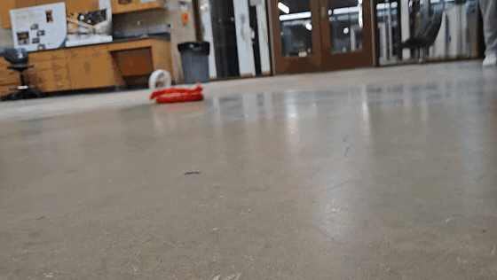

Lead engineer for a 16 person ASME team. Our $100 radio controlled hovercraft won Best Hovercraft for 2024 to 2025.

| Context | Dates | My role | Team | Tools | Outcome |
|---|---|---|---|---|---|
| ASME Design Team, Penn State (Team Driftstorm) | 2024 to 2025 season, competition March 2025 | Lead engineer | 16 students | Fusion 360, Fusion simulation, weighted decision matrix | First place, Best Hovercraft |

**Case study:** [PDF](docs/Hovercraft_Case_Study.pdf) · [web version](https://xiang-wang-us.github.io/projects/hovercraft.html)

## Highlights

- **1st** place, Best Hovercraft 2024 to 2025
- **$100** budget beyond the standard kit
- **8 × 10** skirt trade study: materials by weighted criteria

## Summary

I led design for a 16 person team building a radio controlled hovercraft on a $100 budget with a fixed kit of motors and batteries. We went from a first flight with four failure modes to a second revision that won the competition. I ran the skirt material trade study, set the rudder geometry, and drove the redesigns after each test.

## Brief and constraints

Every team received the same MT2204 2300 KV motors, 40 A ESCs, and 11.1 V LiPo battery, and could not buy stronger replacements. Everything else had to fit in $100 across two semesters, and teams had to model their own reference parts instead of importing them. The competition scored drag races and a precision course.

The team settled on one chassis, one lift fan, one thrust fan with twin rudders, and one skirt. I built the reference models for the motor and skirt and documented the wiring diagram.

<table>
<tr><td width="50%" valign="top">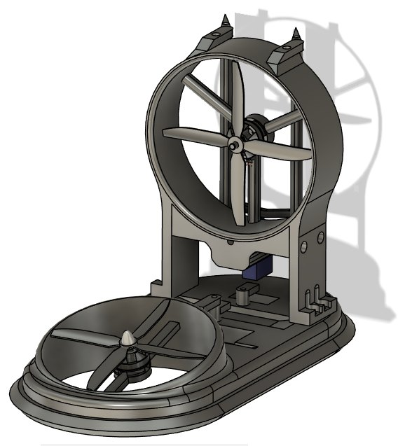 First revision</td><td width="50%" valign="top">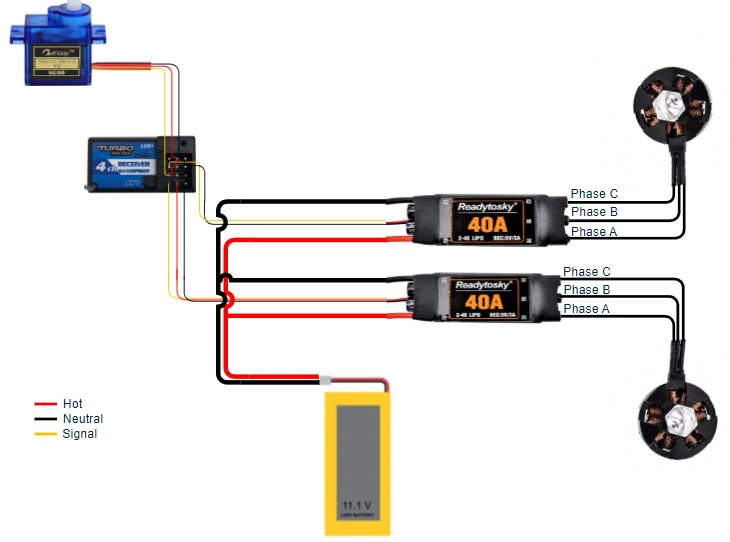 Wiring diagram: receiver, servos, two ESCs, lift and thrust motors</td></tr>
</table>

## Skirt material trade study

The skirt holds the air cushion, so it decides whether the craft hovers at all. With Logan Alefantis I scored eight materials against ten criteria. The weights favored air and water impermeability, abrasion resistance, durability, and weight, and pushed UV and weather resistance down because the craft runs indoors for short periods.

Polyurethane coated nylon scored 157.4 of a possible 171, about 10% ahead of PVC coated fabric and Hypalon. It was also the lightest and cheapest of the top three, and ripstop versions keep a tear from spreading.

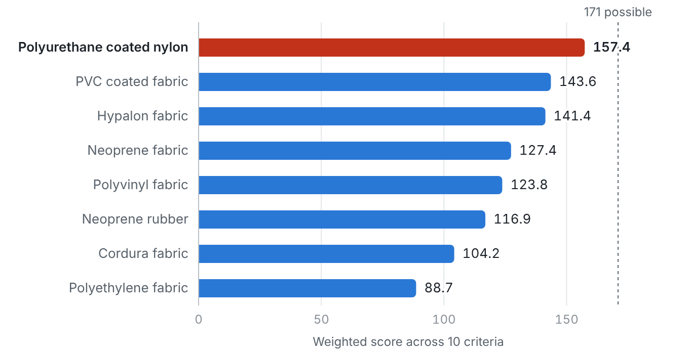 Weighted scores for eight candidate skirt materials

<table>
<tr><td width="50%" valign="top">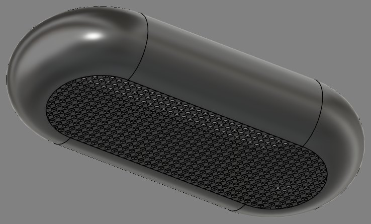 Skirt reference model</td></tr>
</table>

## Rudders and steering

A vector sketch of the thrust stream across a deflected rudder showed the turning force peaks at 45 degrees. I capped rudder travel at plus or minus 45 degrees, so the servos and linkage only had to cover that range.

The plastic rudder pins kept breaking, so titanium rods replaced them for about $7. I also designed a custom servo horn with the spline modeled in, replacing the supplied horn to save parts, assembly, and weight. The spline was too small to measure directly, so I took a reference diameter and drew the teeth by hand in CAD. FDM printers could not hold the teeth, so the horn needed resin printing.

<table>
<tr><td width="50%" valign="top">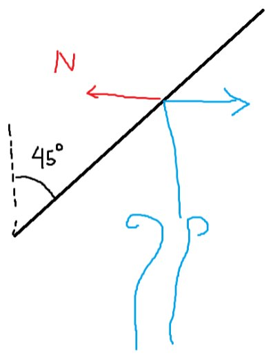 Thrust deflection sketch used to set travel</td><td width="50%" valign="top">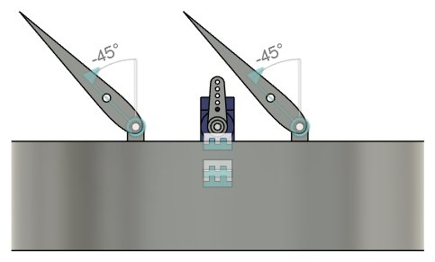 Rudders at the 45 degree limit</td></tr>
<tr><td width="50%" valign="top">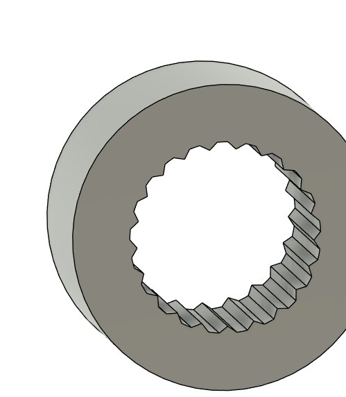 Custom servo horn spline</td></tr>
</table>

## First flight and redesign

The first flight showed four problems: the craft bobbed, thrust pushed the bow into the floor, the angled lift fan behaved unpredictably, and the skirt pulled out of its clamp. Looking at the clamp, force concentrated near the fasteners and left the long edges loose, so I proposed a continuous clamp with a compliant strip pressing the skirt evenly.

Revision two changed three things: a flat fan instead of the angled one, better component placement, and an angled propeller. I proposed an isogrid propulsion duct to cut weight, reworked the rudder, servo, and leg mounts, and removed a bulky part that was not needed, checking the lighter structure in simulation.

<table>
<tr><td width="50%" valign="top">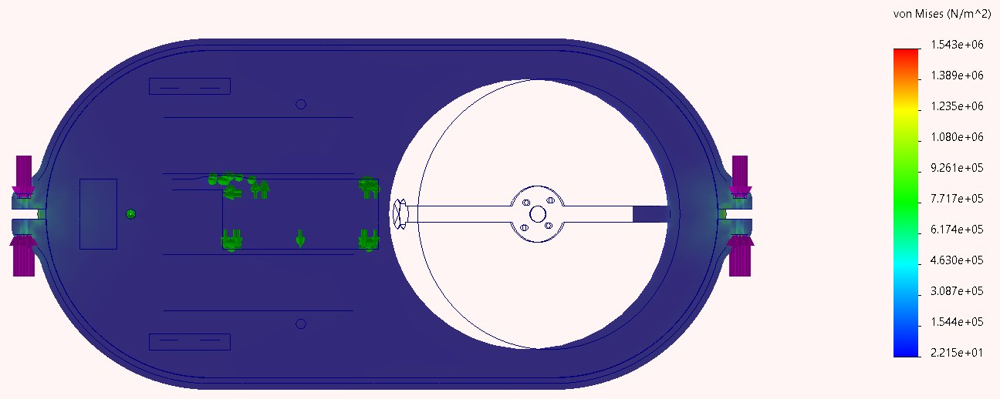 Clamp load: force only near the ends</td><td width="50%" valign="top">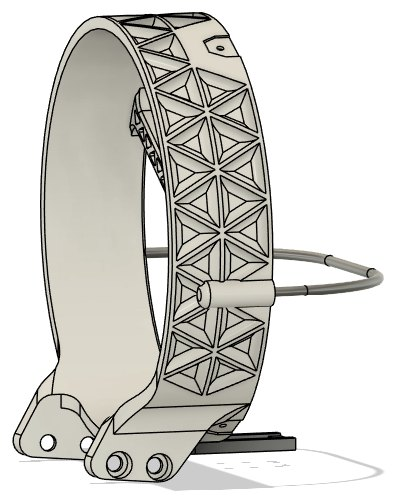 Isogrid thrust duct</td></tr>
<tr><td width="50%" valign="top">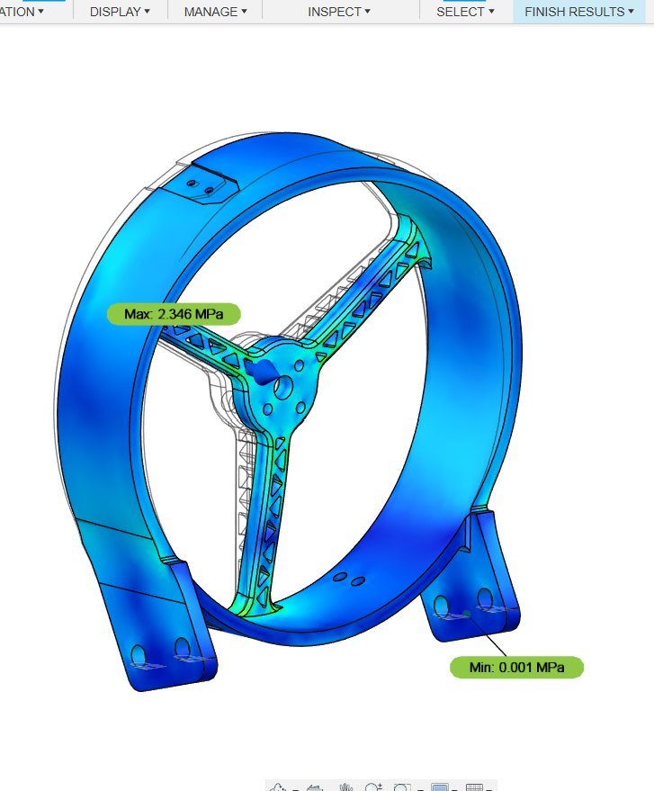 Duct stress check</td></tr>
</table>

## Testing and result

A second round of tests covered maneuverability, response time, and precision driving, and caught excess skirt material being pulled into the lift fan. The final revision added a protective halo and a hull profile shaped for forward flight.

At the March 2025 competition the craft won Best Hovercraft. One drag race ended in a tie and had to be rerun.

<table>
<tr><td width="50%" valign="top">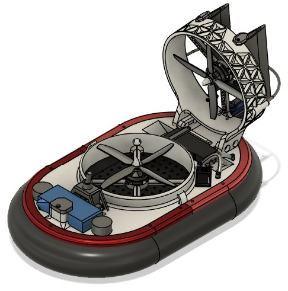 Final design</td><td width="50%" valign="top">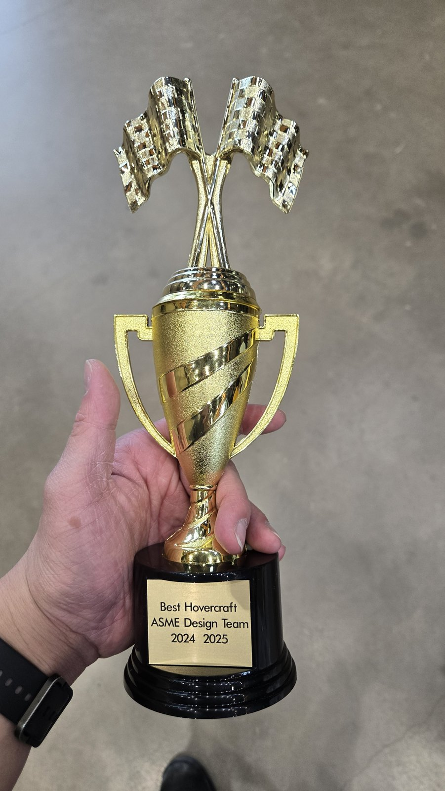 Best Hovercraft, ASME Design Team 2024 to 2025</td></tr>
<tr><td width="50%" valign="top">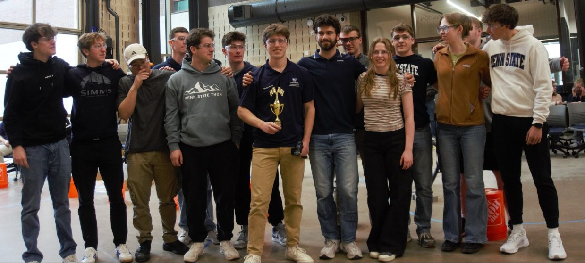 Team Driftstorm</td></tr>
</table>

Videos: [Test run, February 2025](media/video/hover_closepass.mp4), [Drag race at the competition](media/video/hover_dragrace.mp4)

## Files

| File | Path |
|---|---|
| Case study (PDF) | [`docs/Hovercraft_Case_Study.pdf`](docs/Hovercraft_Case_Study.pdf) |
| Skirt material study (PDF) | [`docs/Hovercraft_Skirt_Material_Study.pdf`](docs/Hovercraft_Skirt_Material_Study.pdf) |
| Design journal (PDF) | [`docs/Hovercraft_Design_Journal.pdf`](docs/Hovercraft_Design_Journal.pdf) |
| Main assembly, revision 1 (STEP) | [`cad/Hovercraft_Main_Assembly_V1.step`](cad/Hovercraft_Main_Assembly_V1.step) |
| Main assembly, revision 2 (STEP) | [`cad/Hovercraft_Main_Assembly_V2.step`](cad/Hovercraft_Main_Assembly_V2.step) |

## Credits

Built with the 16 members of Team Driftstorm, ASME at Penn State. Skirt study coauthored with Logan Alefantis.

---

Part of [Xiang Wang's engineering portfolio](https://xiang-wang-us.github.io). [LinkedIn](https://linkedin.com/in/xiangwang102) · [Email](mailto:20o5xwang@gmail.com)
